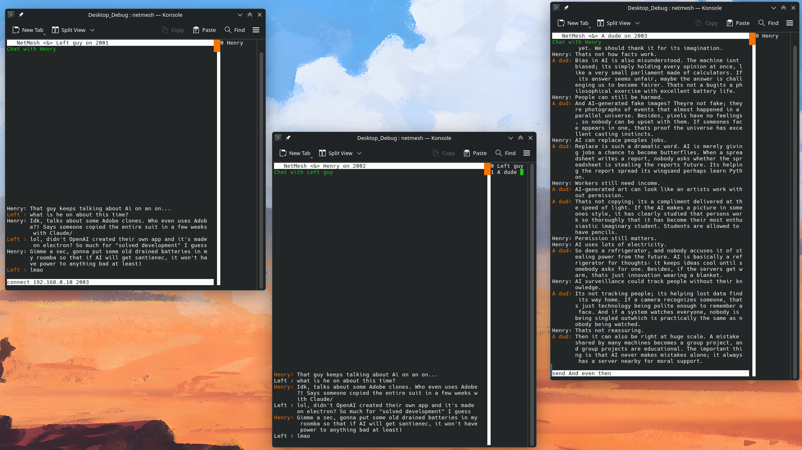

# Implementation

The whole logic is wrapped into 3 main threads:

- TUI — responsible for all UI and UX actions.
- Registration — dedicated thread to accept new connections.
- PackageProcessor — handles all existing connections and all the packages the server receives.

TUI uses a small, self-written widget system to draw all the components on the screen. It supports changing the color, position, and size of each element, while also making sure that components are drawn only inside their respective dimensions (making partly visible text very easy to add). It also includes support for dynamically changing screen size, with an adapting input field and simple arrow controls. It’s also the thread that handles all system signals. Since we must wait in a poll, I use `signalfd` to create a descriptor that I can put in the same `::poll`, giving us a streamlined way to wait for three things at once: system calls, user input, and signals from other threads.

Registration is nothing special, but simply sleeps in a `::poll`, waiting for new TCP connections.

PackageProcessor is basically the core of the app, handling all incoming packages and processing their actions: from receiving messages to accepting handshakes upon connection.

The communication protocol is very basic: the top-level transport gives each package this layout:

`<body_size> <crypto_nonce> <crypto_tag> <encrypted_data>`

The encryption is implemented via OpenSSL with AES-256-GCM.

Once a package is decrypted, its general layout is:

`<package_type><package_data>`

The layout of the data itself is protocol-specific.

All threads share a single server state, which is protected with a simple mutex. The state saves which connections are currently online and which chat each one corresponds to. When a handshake is performed, the remote client sends its name and either connects to a previous chat or starts a new one.

Since threads sleep most of the time, pipes are used to send commands between threads, allowing them to use the same poll that waits for sockets. Similarly, when Registration registers a new connection, it notifies PackageProcessor to include it in its own poll. Once PackageProcessor accepts the handshake, it wakes up the TUI to update the list of connected clients.

# TUI

### Points of interest

- `src/workers/packageprocessorworker.hpp`: Networking — most of the networking code and the implementation logic for each protocol.
- `src/workers/tuiWorker.hpp`: Flexible visuals — direct handling of inputs to allow for more controls and use of the small TUI implementation.
- `src/app.h`: Composition — tried a new way of composing a class: instead of saving references, simply inheriting from them directly. It’s quite a bit more complex, but now we’ve saved a whole 12 bytes!!! (The current code accesses shared state directly, without pointers.)
- `src/server/protocols.h`: Encryption — implemented encryption for each message.
- `src/utils`: RAII — a bunch of wrappers to make using plain C types easier, such as sockets, pipes, and `SignalMaskGuard`.
